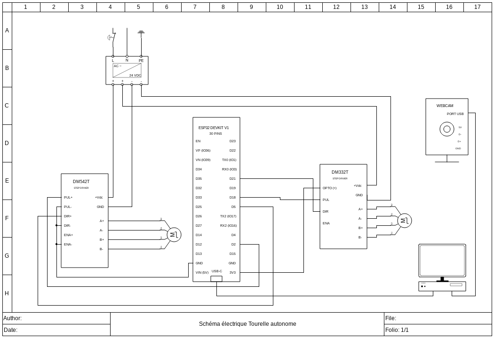

# Tourelle autonome

[← Retour à l'accueil du portfolio](./)

## Sommaire
 
- TOC
{:toc}
## 🎯 Le projet
 
Une tourelle qui repère une personne dans son champ de vision et la suit du regard, toute seule. Elle tourne à gauche et à droite, regarde vers le haut et vers le bas, et garde la personne au centre de l'image, même quand elle bouge vite.
 
J'ai tout fait de A à Z : la mécanique, l'électronique, le programme de vision par intelligence artificielle et le réglage du suivi. Le projet réunit mes compétences en mécanique, en électronique, en informatique et en automatique.
 
[À compléter : vidéo de démonstration]
 
### En bref
 
| | |
| --- | --- |
| 🧠 **Détection** | Intelligence artificielle YOLOv8, en temps réel |
| 🔄 **Mouvement** | 2 axes motorisés (rotation et inclinaison) |
| 🎚️ **Finesse** | Résolution d'environ 0,02° par pas moteur |
| ⚡ **Vitesse** | Jusqu'à environ 160 °/s en rotation et 225 °/s en inclinaison |
| 🏗️ **Solidité** | Base montée sur une couronne d'orientation qui supporte 300 kg |
| 🛠️ **Fabrication** | Pièces modélisées sous SolidWorks et imprimées en 3D |
 
---
 
## 🧩 Comment ça marche
 
Le principe est le même que pour une personne qui suit quelqu'un des yeux : voir, comprendre, décider, agir.
 
1. **Voir.** Une caméra filme la scène en continu.
2. **Comprendre.** Un ordinateur analyse chaque image avec un modèle d'intelligence artificielle (YOLOv8), qui repère les personnes et donne leur position.
3. **Décider.** Un algorithme d'asservissement (PID) mesure l'écart entre la personne et le centre de l'image, puis calcule à quelle vitesse et dans quel sens il faut tourner pour le corriger.
4. **Agir.** Un microcontrôleur (ESP32) transforme cette décision en signaux électriques pour les moteurs, qui font bouger la tourelle.
Ces quatre étapes se répètent en boucle, plusieurs fois par seconde.
 
[À compléter : schéma de la chaîne caméra → ordinateur → ESP32 → moteurs]
 
---
 
## 🛠️ Ce que ce projet montre
 
| Domaine | Ce que j'ai fait |
| --- | --- |
| **Conception mécanique** | Modélisation sous SolidWorks, impression 3D, conception d'un système de réglage de la tension de courroie |
| **Électronique de puissance** | Choix et dimensionnement des moteurs, des drivers et de l'alimentation |
| **Intelligence artificielle** | Détection de personnes en temps réel avec YOLOv8 |
| **Automatique** | Asservissement par deux correcteurs PID, un par axe |
| **Systèmes embarqués** | Pilotage des moteurs avec un ESP32 |
| **Intégration** | Mise en cohérence de la mécanique, de l'électronique et du logiciel |
 
---
 
## ⚙️ Conception mécanique
 
### Une base pensée pour évoluer
 
Le poids de la tourelle ne repose pas sur le moteur mais sur une **couronne d'orientation** en aluminium, fixée au bâti. Le moteur n'a plus qu'à la faire tourner. J'ai choisi une couronne qui supporte 300 kg pour pouvoir faire évoluer la tourelle et son équipement sans avoir à refaire toute la base.
 
Le corps de la tourelle se monte et se démonte facilement. Je peux donc le remplacer, par exemple par une version en aluminium ou par un corps qui porte un autre équipement. Sa forme en **U** répartit le poids de la caméra de façon équilibrée.
 
### Des choix qui répondent à des contraintes précises
 
- **Rotation (pan).** Un moteur puissant (2,4 N·m) entraîne la couronne par un pignon. Une réduction d'environ 7:1 multiplie le couple et rend le pilotage plus précis.
- **Inclinaison (tilt).** Un moteur plus petit entraîne l'axe par une courroie, avec une réduction de 5:1. J'ai conçu moi-même un **galet tendeur à vis** pour régler la tension de la courroie.
- **Fixation de l'axe d'inclinaison.** Pour maintenir les roulements, je me suis inspiré de la fixation d'un vilebrequin de moteur de voiture : deux demi-sphères s'emboîtent autour des roulements et les serrent.
[À compléter : photos du montage et captures SolidWorks]
 

<strong>Détails techniques de la mécanique</strong>

**Axe pan**
 
- Couronne d'orientation BS Rollen D84.330 : diamètre de 330 mm, 300 kg en compression, 176 dents en aluminium. Ses dents sont orientées selon l'axe vertical et non radialement, ce qui a compliqué l'intégration du moteur sur le bâti.
- Moteur NEMA 23 (23HS32-4004S) : 2,4 N·m, arbre de 8 mm. Le diamètre de l'arbre correspond à celui des pignons compatibles avec la couronne et assure une bonne tenue en torsion.
- Pignon de modélisme en acier : 25 dents, module 1,5, alésage de 8 mm. Rapport de réduction : 176/25, soit environ 7:1.
**Axe tilt**
 
- Moteur NEMA 17 (17HS16-2004S1) : 45 N·cm, arbre de 5 mm.
- Pignon GT2 en aluminium de 16 dents sur le moteur, pignon de 80 dents imprimé en 3D sur l'axe, courroie GT2. Rapport de réduction : 5:1.
- Support de caméra symétrique, avec un axe à chaque extrémité logé dans les roulements du corps.
**Corps de la tourelle**
 
- Imprimé en PLA. Les paramètres d'impression visaient à maximiser la tenue en compression tout en imprimant la pièce en une seule fois : [à compléter : remplissage, nombre de parois, orientation, buse, etc.].
- Les demi-sphères sont modélisées avec un ajustement serré pour bien maintenir les roulements.
**Rapports de réduction et résolution**
 
Les drivers sont réglés à 3200 impulsions par tour moteur.
 
| Axe | Réduction | Résolution | Vitesse max |
| --- | --- | --- | --- |
| Pan | ≈ 7:1 | ≈ 0,016° par pas | ≈ 160 °/s |
| Tilt | 5:1 | ≈ 0,022° par pas | ≈ 225 °/s |
 

---
 
## 📟 Électronique
 
La tourelle est pilotée par deux moteurs pas à pas, chacun avec son driver, le tout alimenté par une alimentation industrielle 24 V. L'ESP32 reçoit les ordres de l'ordinateur via communication série USB et les transmet aux drivers.
 
J'ai choisi des **drivers de type industriel** pour garder un câblage simple et robuste. Chaque moteur est associé à un driver adapté à son courant, pour avoir le couple nécessaire sans surdimensionner inutilement les composants.
 
L'alimentation est volontairement surdimensionnée, car elle sert aussi à d'autres projets. Pour la tourelle seule, elle travaille à environ 20 % de sa capacité : elle chauffe peu, ne chute pas en tension lors des accélérations et laisse de la marge pour ajouter d'autres équipements.

 
 

<strong>Détails techniques de l'électronique</strong>

**Moteurs et drivers**
 
| Axe | Moteur | Courant moteur | Driver | Plage du driver |
| --- | --- | --- | --- | --- |
| Pan | NEMA 23 (2,4 N·m) | 4,0 A par phase | DM542T | jusqu'à 4,2 A crête, 20 à 50 VDC |
| Tilt | NEMA 17 (45 N·cm) | 2,0 A par phase | DM332T | jusqu'à 3,2 A crête, jusqu'à 36 VDC |
 
Les deux drivers utilisent une commande par processeur de signal (DSP). Elle réduit les résonances, lisse le micro-pas et limite l'échauffement à l'arrêt.
 
**Alimentation Mean Well LRS-350-24 (24 V, 14,6 A, 350 W)**
 
- **Tension de 24 V.** Elle donne une bonne dynamique au NEMA 23 à vitesse moyenne et haute, tout en restant sous la limite du DM332T (36 VDC).
- **Marge.** Environ 280 W de réserve permettent d'ajouter des actionneurs, des capteurs ou des convertisseurs sur le même bus.
**Bilan de puissance** (estimations en régime dynamique, à confirmer par une mesure)
 
| Poste | Puissance estimée | Courant sous 24 V |
| --- | --- | --- |
| Axe pan | ≈ 48 W | ≈ 2,0 A |
| Axe tilt | ≈ 18 W | ≈ 0,75 A |
| Pertes et auxiliaires | ≈ 4 W | ≈ 0,15 A |
| **Total** | **≈ 70 W** | **≈ 2,9 A** |
| Capacité de l'alimentation | 350 W | 14,6 A |
| **Taux de charge** | **≈ 20 %** | |
 
Le courant dans les moteurs est bien supérieur au courant tiré sur l'alimentation, car les drivers fonctionnent en découpage. C'est pourquoi le bilan se fait en puissance côté 24 V. L'ESP32 est alimenté par l'USB de l'ordinateur et n'est donc pas sur ce bus.
 
**Pilotage par l'ESP32**
 
- Il reçoit pour chaque axe une consigne de vitesse comprise entre -1 et 1.
- Le signe donne le sens de rotation, et la valeur absolue donne la fréquence des impulsions envoyées au driver, jusqu'à 10 kHz.
- Une zone morte maintient l'axe immobile pour de très faibles consignes.
- Les deux axes sont traités indépendamment. L'adoucissement des variations de vitesse est assuré en amont par l'ordinateur.

---
 
## 🖥️ Vision et asservissement
 
### De l'image à la consigne
 
La caméra envoie son image à un ordinateur, qui y repère les personnes avec **YOLOv8**, un modèle d'intelligence artificielle de détection d'objets. Quand il y en a plusieurs, la tourelle suit celle que le modèle détecte avec le plus de certitude.
 
Elle ne vise pas le centre du corps mais le haut, à peu près la tête et les épaules, ce qui donne un suivi plus naturel.
 
### Un suivi réactif
 
Deux correcteurs PID, un par axe, transforment l'écart entre la personne et le centre de l'image en consigne de vitesse. Pour que la tourelle réagisse vite et reste agréable à regarder, j'ai travaillé sur trois points :
 
- **Latence réduite.** La capture de l'image tourne en parallèle du reste du programme, pour que l'analyse porte toujours sur l'image la plus récente et jamais sur une image déjà ancienne.
- **Mouvements adoucis.** Les consignes sont lissées pour éviter les à-coups.
- **Comportement sûr.** Quand la personne disparaît, la tourelle ralentit progressivement au lieu de s'arrêter net. À la fermeture du programme, les deux axes reçoivent un ordre d'arrêt.

<strong>Détails techniques de la partie informatique</strong>

- Caméra : webcam Logitech 720p utilisée en 640 × 480, en attendant de passer sur une caméra de meilleure résolution.
- Modèle : YOLOv8 dans sa version la plus légère, avec une analyse sur des images réduites pour gagner en vitesse. Seule la classe « personne » est conservée, avec un seuil de confiance de 50 %.
- Les écarts sont normalisés entre -1 et 1 pour chaque axe, ce qui permet de traiter les deux axes de la même façon.
- Chaque correcteur PID comporte une protection contre la saturation de l'intégrale (anti-windup).
- Un filtre passe-bas lisse les consignes avant leur envoi.
- Le réglage des PID est indépendant sur chaque axe, car la gravité et l'inertie ne s'y exercent pas de la même façon.
- Bibliothèques utilisées : Ultralytics (YOLOv8) et OpenCV.

---
 
## 📊 Résultats et pistes d'amélioration
 
Le suivi est fluide, et les correcteurs gardent bien la personne dans le champ, y compris quand elle accélère.
 
Le réglage fin continue :
 
- **Stabilité à l'arrêt.** Il reste de petits mouvements parasites autour de la position de repos. [À compléter : cause identifiée et pistes testées]
- **Réactivité de l'inclinaison.** Cet axe doit encore être réglé pour mieux suivre les mouvements rapides.
- **Caméra.** Une caméra de meilleure résolution améliorerait la détection à distance.
[À compléter : fréquence d'images obtenue, latence, ordinateur utilisé]
 
### Évolutions envisagées
 
- Remplacer le corps en PLA par un corps en aluminium, plus rigide.
- Passer sur une caméra de meilleure résolution.
- Équiper la tourelle d'outils supplémentaires, ce pour quoi la base a été conçue.
---
 
## 🔗 Liens
 
- Dépôt du projet : [À compléter : lien GitHub]
- Technologies utilisées : [YOLOv8 (Ultralytics)](https://docs.ultralytics.com/models/yolov8/) et [OpenCV](https://opencv.org/)
